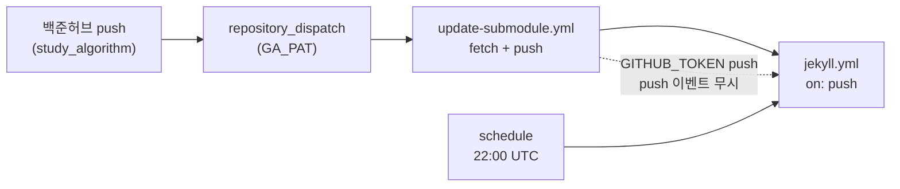

* TOC
{:toc}

---

## 1. 전편에서 남은 것

(2)편 마지막에 적어둔 것처럼, 서브모듈 Fetch는 잘 되는데 그다음이 안 이어진다. 
처음엔 뭔가 내가 YAML을 잘못 쓴 줄 알았다. 시크릿도 다시 넣어보고, push 단계 로그도 여러 번 봤다. 

결론부터 말하면, **내 실수가 아니었다.** GitHub Actions 쪽 정책 때문이다. 
별거 아닌 일인데, 한참 헤맸으니 정리해둔다.

## 2. 실제로 돌아가는 흐름

지금 파이프라인을 그려보면 대략 이렇다.

백준허브가 `study_algorithm` 레포에 push하면, 그 레포의 [`trigger-main-repo.yml`](https://github.com/Kimsc9976/Kimsc9976.github.io/blob/main/modules/Algorithm/.github/workflows/trigger-main-repo.yml)이 `repository_dispatch`로 메인 레포를 깨운다. 
메인 레포의 [`update-submodule.yml`](https://github.com/Kimsc9976/Kimsc9976.github.io/blob/main/.github/workflows/update-submodule.yml)이 서브모듈을 fetch하고, 바뀐 게 있으면 커밋해서 push한다. 

여기까지는 잘 된다. 로그에도 fetch 성공, push 성공이 찍힌다. 

## 3. 어디서 끊기나

문제는 그다음이다. 

`update-submodule.yml`은 checkout과 push에 `GITHUB_TOKEN`을 쓴다. 
GitHub 문서([Triggering a workflow](https://docs.github.com/en/actions/using-workflows/triggering-a-workflow))에 이렇게 나와 있다.

> `GITHUB_TOKEN`으로 수행한 작업이 발생시키는 이벤트는 새 workflow run을 만들지 않는다. (무한 루프 방지)
>
> 예외: `workflow_dispatch`, `repository_dispatch`

쉽게 말하면, Actions 봇이 push한 커밋은 **`on: push`로 걸어둔 다른 workflow를 깨우지 않는다**는 뜻이다. 

그래서 submodule 포인터가 main에 올라가도, [`jekyll.yml`](https://github.com/Kimsc9976/Kimsc9976.github.io/blob/main/.github/workflows/jekyll.yml)은 자동으로 안 돈다. 
Ruby 스크립트로 `_algorithm/**` 만드는 것도, Jekyll build도, Pages 배포도 — 전부 `jekyll.yml` 안에 있으니, 이 체인이 끊긴다. 

`repository_dispatch`로 `update-submodule.yml` 자체는 실행되지만, 그 workflow가 push로 `jekyll.yml`을 연쇄 실행시키는 건 정책상 안 된다. 
PAT로 push하면 트리거는 되지만, 그건 나중에 필요하면 생각해보기로 하고 일단 넘어갔다.

## 4. 그래서 스케줄러로 대체했다

끊긴 구간을 메우는 방법은 단순하다. **매일 정해진 시간에 workflow를 돌린다.**

| workflow | cron (UTC) | KST |
|----------|------------|-----|
| `update-submodule.yml` | `0 21 * * *` | 06:00 |
| `jekyll.yml` | `0 22 * * *` | 07:00 |

서브모듈 갱신이 6시, 빌드·배포가 7시쯤 돈다. 
백준허브로 문제를 올려도 사이트에 바로 반영되진 않지만, **하루 안에는 올라온다.** 

알고리즘 풀이 기록용 블로그니까 실시간성까지는 필요 없었다. 이 정도면 충분하다. 

`update-submodule.yml` 커밋 메시지에 `[skip ga]` 태그를 넣어둔 것도 같은 맥락이다. 
스케줄로 submodule만 갱신될 때 GA4 API를 매번 치지 않게 하려는 것이다. [`jekyll.yml`](https://github.com/Kimsc9976/Kimsc9976.github.io/blob/main/.github/workflows/jekyll.yml)에서 해당 태그가 있으면 `get-ga-data` job을 건너뛴다. 

## 5. 정리

처음엔 "Fetch는 되는데 Auto Push가 안 된다"고 적어뒀는데, 정확히 말하면 이렇다.

- submodule fetch · push → **된다**
- push로 `jekyll.yml` 자동 실행 → **정책상 안 된다**
- 매일 스케줄로 빌드·배포 → **이걸로 대체했다**

크게 문제될 일은 아니다. 백준허브 → 서브모듈 레포 push → 메인 레포 submodule 갱신까지는 이벤트 기반으로 돌아가고, 사이트 반영만 하루 한 번 스케줄에 맡긴다. 

(1)에서 그렸던 전체 흐름도가 거의 다 연결됐다. 마지막 고리만 "실시간"이 아니라 "매일 아침"일 뿐이다. 

이상으로 백준허브–Github.io 연동기 시리즈를 마친다.

자동매매 알고리즘 리포트 와 매매기록도 이방식을 사용할 것 같다.
